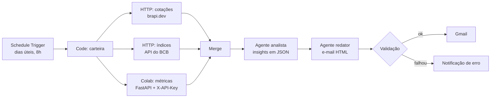

# Assistente de Briefing de Carteira (n8n + IA)

Automação no **n8n** que envia, todo dia útil às 8h, um e-mail com o resumo de uma carteira de investimentos fictícia, os indicadores do dia (Selic, CDI, dólar) e um comentário gerado por agentes de IA.

Projeto prático desenvolvido a partir do curso de criação de assistentes de investimento com IA (Colab, Webhooks, HTTP + Code + Merge, agentes de IA, LLM e Gmail).

> **Aviso:** projeto didático. O assistente não faz recomendação de compra ou venda de ativos.

## Como funciona



1. O **Schedule Trigger** dispara o fluxo às 8h, de segunda a sexta.
2. Um nó **Code** define a carteira (5 ativos).
3. Três consultas rodam em paralelo: cotações (brapi.dev), indicadores (Banco Central) e métricas calculadas pelo serviço Python no Colab.
4. O **Merge** junta tudo num único item.
5. O **agente analista** gera insights em JSON e o **agente redator** escreve o e-mail.
6. Um nó **IF** valida o conteúdo. Se estiver ok, o **Gmail** envia; se não, um alerta de erro é disparado.

Detalhes em [docs/arquitetura.md](docs/arquitetura.md).

## Estrutura do repositório

```
.
├── README.md
├── .env.example                 # variáveis necessárias (sem valores reais)
├── .gitignore
├── carteira/
│   └── carteira-exemplo.json    # carteira fictícia usada no fluxo
├── colab/
│   ├── servico_metricas.py      # API FastAPI que roda no Colab
│   └── requirements.txt
├── docs/
│   ├── escopo.md                # escopo, etapas e critérios de aceite
│   ├── arquitetura.md           # fluxo, nós e contrato de dados
│   └── tratamento-de-erros.md   # retry, fallback e notificações
├── prompts/
│   ├── agente-analista.md
│   └── agente-redator.md
├── templates/
│   └── email-briefing.html      # modelo do e-mail
├── workflows/
│   └── README.md                # onde fica o export do n8n
└── prints/                      # capturas do e-mail e do fluxo
```

## Pré-requisitos

- n8n (cloud ou self-hosted)
- Conta Google com Gmail (credencial OAuth no n8n)
- Chave de API de um provedor de LLM (OpenAI, Anthropic, Google etc.)
- Token gratuito da [brapi.dev](https://brapi.dev)
- Google Colab (para o serviço Python do MVP)

## Como rodar

1. **Serviço no Colab**
   - Abra um notebook, instale as dependências de `colab/requirements.txt` e cole o conteúdo de `colab/servico_metricas.py`.
   - Defina `API_KEY` e `BRAPI_TOKEN` nos *Secrets* do Colab.
   - Suba o túnel (ngrok ou cloudflared) e copie a URL pública.
2. **n8n**
   - Importe o workflow de `workflows/`.
   - Crie as credenciais: *Header Auth* (`X-API-Key`), LLM e Gmail.
   - Atualize a variável com a URL do túnel do Colab.
3. **Teste**
   - Execute o fluxo manualmente e confira o e-mail.
   - Rode os testes de falha listados em [docs/escopo.md](docs/escopo.md#critérios-de-aceite).

## Segurança

- Nenhum token ou chave fica no código: use credenciais do n8n e *Secrets* do Colab.
- O arquivo `.env` está no `.gitignore`. Use `.env.example` como referência.
- Antes de exportar o workflow, confira que ele não carrega credenciais embutidas.

## Próximos passos

- Tirar o serviço Python do Colab (Docker ou nó Code em Python).
- Ler a carteira de uma planilha Google Sheets.
- Guardar o histórico diário em banco e incluir gráfico semanal.
- Alertas pontuais por Telegram ou Teams.
